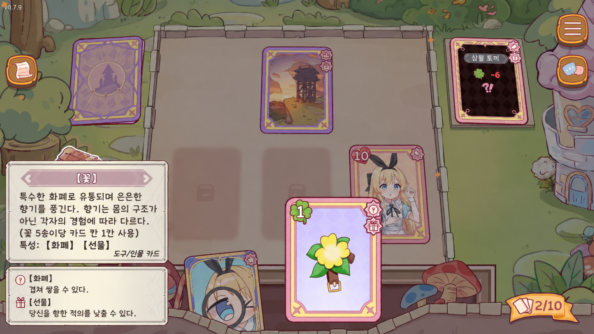

# 앨리스와 피안 — 한국어 패치

*대표 한글화 리소스: 카드 도움말. 이미지 속 v0.7.9는 원본 도움말에 남아 있는 예시 화면 표기입니다.*

**이 프로젝트는 GPT Astra를 사용한 AI 번역의 결과물입니다.**
일본어 리소스를 기준으로 영어·중국어를 비교해 번역했으며, 그래픽의 한국어 문구는
이미지 생성 기능을 활용해 작업했습니다. 사용자 제공 **학교안심 그림일기** 글꼴을 사용합니다.
공식 한국어판이 아닌 비공식 패치이며, 오역이나 문맥상 어색한 표현이 남아 있을 수 있습니다.

대상: Windows / 게임 1.0.5·1.0.6 / 한국어 패치 v1 / 인스톨러 1.1.0

## 다운로드와 설치

게임 버전에 맞는 릴리즈에서 ZIP 파일을 내려받으세요.

| 게임 버전 | 배포판 | 번역 항목 |
| --- | --- | ---: |
| 1.0.5 | [1.0.5용 한국어 패치 v1](https://github.com/pnpcrow/alicenation-translation-korean/releases/tag/v1-game-1.0.5) | 7,410 |
| 1.0.6 | [1.0.6용 한국어 패치 v1](https://github.com/pnpcrow/alicenation-translation-korean/releases/tag/v1-game-1.0.6) | 7,417 |

1. 게임을 종료하고 ZIP의 압축을 풉니다.
2. `Alicenation-Korean-v1.exe`를 실행해 `alicenation.exe`가 있는 게임 폴더를 선택합니다.
3. **한국어 패치 적용**을 누르고 완료될 때까지 기다립니다.
4. 게임의 언어 설정에서 **한국어**를 선택합니다. 기존 중국어 간체 슬롯을 대체합니다.

복구하려면 게임을 종료한 뒤 같은 인스톨러의 **원상 복구**를 누릅니다.
게임 폴더의 `.alicenation-korean`에 원본 백업이 보관되므로 복구 전에는 지우지 마세요.
게임 업데이트 전 먼저 복구하고, 업데이트 후 해당 버전의 패치를 적용하세요.
저장 데이터는 변경하지 않습니다. 패치는 게임 본편을 포함하지 않으므로 기존 게임이 필요합니다.

## 번역과 검증

텍스트 7,410항목(1.0.5)·7,417항목(1.0.6), 언어표 밖 화면 문구 90개와 이미지 43개를 한국어로 바꿉니다.
1.0.6의 템플릿 이름·설명 두 항목은 일본어가 비어 있어 중국어 원문을 참고했습니다.
한국어 단어 단위 줄바꿈을 적용하며, 공용 연출·그림은 다른 언어를 골라도 한국어로 표시될 수 있습니다.

번역표의 누락·변수·서식, 폰트, 이미지 재삽입, 파일 무결성을 검사했습니다.
두 버전 각각 설치·중복 설치·원상 복구를 반복 검증했고, 13개 Rust 테스트를 통과했습니다.
실제 타이틀·언어 선택·프롤로그·초반 튜토리얼·도움말을 확인했습니다.
모든 이야기 분기와 엔딩을 끝까지 플레이한 것은 아닙니다.
자세한 내용은 [검증 기록](docs/qa.md)과 [번역 결정 기록](docs/translation-decisions.md)에 있습니다.

## 작업 원칙

- 게임 원본의 경로와 SHA-256을 기록하고 작업 폴더의 사본에서 수정한다.
- 원본 게임, 추출한 전체 원문과 빌드 중간 산출물은 Git에 넣지 않는다.
- 번역문, 용어집, 제작 도구, 그래픽 수정본, 인스톨러 코드는 단계별로 커밋한다.
- 패치는 버전과 원본 해시를 검증하며 설치 전 백업을 만든다.
- 복구는 패치가 변경한 파일만 검증된 백업으로 되돌린다.

## 제작 자료

Rust 인스톨러는 원본 해시로 게임 버전을 자동 판별하고, 버전별 백업, 패치, 원상 복구를 지원한다.
각 공개 릴리즈에는 해당 버전용 패치 데이터만 넣은 인스톨러를 제공한다.
제작·재빌드 방법은 [인스톨러 문서](docs/installer.md), 일반 사용 안내는
[사용 안내](docs/release-readme.txt)를 참고한다.

인스톨러 1.1.0은 이전 1.0.5 전용 v1의 설치 기록도 복구할 수 있다.
1.1.0으로 적용한 패치는 1.1.0으로 복구해야 한다. 백업은 버전별로 보존한다.
기존 로컬 배포판과 두 버전 통합 ZIP은 `dist/`에 보존했으며, 공개 릴리즈용 파일은
`dist/releases/`에 만든다. 게임 원본과 빌드 중간 파일은 배포하거나 Git에 포함하지 않는다.

게임과 원본 리소스의 권리는 원저작자에게 있다. 글꼴과 라이브러리의 라이선스 고지는
배포 ZIP의 `licenses/` 및 저장소의 `assets/`에 포함한다.

